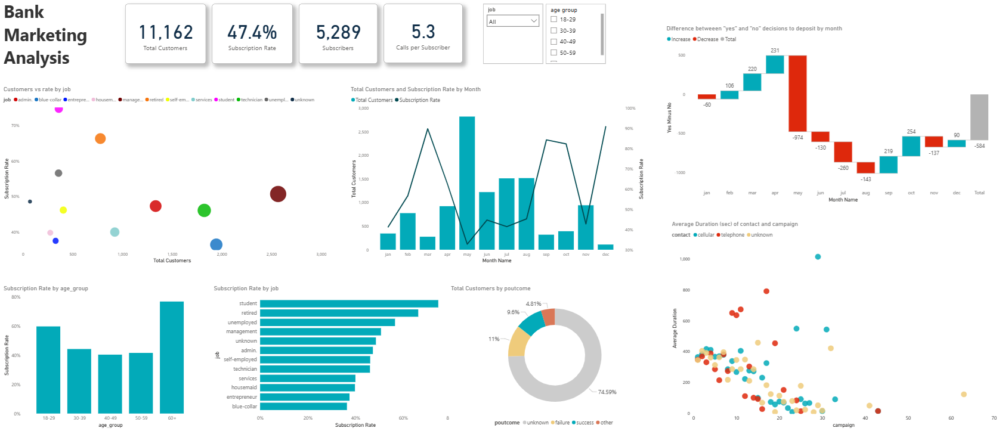

# Bank Marketing Analysis

**Business question:** Which customers are most likely to subscribe to a term deposit, and how can the bank make fewer wasted calls?

## Key finding
September, October, December and March convert at 82-91% but get only about 10% of calls. May-August take about 63% of calls and convert at only 39%.

## Estimated impact
If May-August calls converted like the other months (61%), the bank could get the same number of subscribers with about 2,500 fewer calls (about 23% of all 11,162 calls). This is a rough estimate.

## Recommendation
- Call students, retired and 60+ customers first.
- Prioritise customers who said yes in a past campaign.
- Reduce cold calls in May-August to customers with unknown contact and unknown call history.

## Data
- Bank Marketing dataset: 11,162 customers, 5,289 subscribers (47.4% rate).
- There is no location column, so I did not analyse location.

## What I found
- **Age:** 60+ (76.9%) and 18-29 (59.8%) subscribe most.
- **Job:** students (74.7%) and retired (66.3%) lead. Blue-collar is low (36.4%) with 1,944 calls.
- **Month:** Dec, Mar, Sep and Oct have 82-91% rates but only about 10% of calls.
- **Past campaign:** previous success converts at 91.3%. Unknown history is about 75% of calls and converts at 40.7%.

## Prediction model (Python)
- Logistic regression predicts whether a customer subscribes.
- Accuracy is 69.6%, compared with 52.6% for always guessing "no".
- I removed `duration` (call length) because it is only known after the call.
- The model agrees with the SQL findings: December, student, October, September and retired push towards "yes". Unknown contact and the months Jan, Nov, Aug and Jul push towards "no".

## Limitations
- The estimate assumes May-August customers can be reached with the same success as other months.
- The data shows patterns, not proof of cause.

## Tools and files
Excel, SQL Server, Python (pandas, scikit-learn), Power BI.
- `bank_marketing_cleaned.xlsx` - cleaned data
- `bank_marketing_queries.sql` - 8 SQL queries
- `bank_logistic_regression.ipynb` - Python model
- `bank_marketing_dashboard.pbix` - Power BI dashboard
